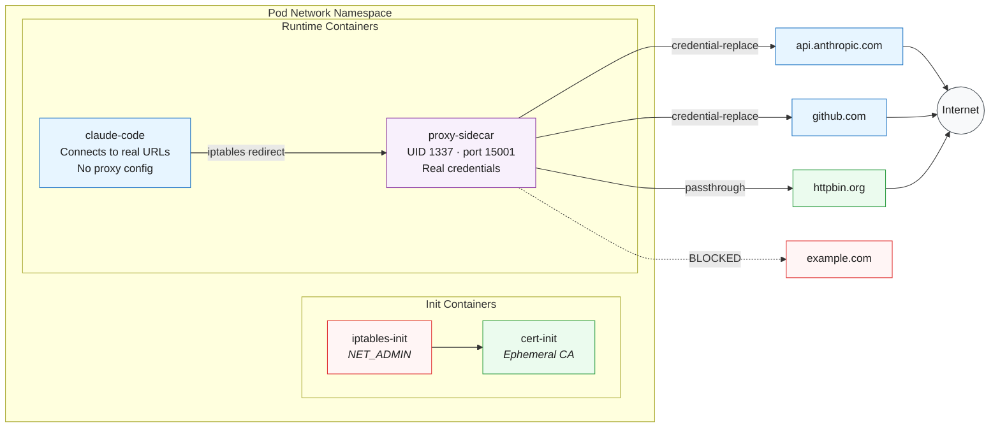

# 03 - Sidecar Proxy for Credential Security

Demonstrates the transparent proxy pattern: a sidecar intercepts all outbound traffic, replaces placeholder credentials with real ones, and enforces a domain allowlist.

## Concept



## What It Does

- The main container connects to real URLs (`https://api.anthropic.com`) — no `HTTPS_PROXY`, no `ANTHROPIC_BASE_URL`
- iptables transparently redirects all egress TCP to the proxy
- The proxy identifies destinations via TLS SNI and replaces placeholder credentials with real ones from the sidecar's environment
- Domains not in the list are blocked (default `strict` mode)

The proxy can only detect HTTP and HTTPS destinations. Raw TCP protocols like SSH, PostgreSQL, and Redis cannot be identified by hostname — for those, use `allow-everything` mode combined with Kubernetes NetworkPolicy (see [08-network-policy](../08-network-policy/)).

For full proxy documentation, configuration options, and operating modes, see [proxy/](../proxy/).

## Why Not HTTPS_PROXY?

The `HTTPS_PROXY` / `NO_PROXY` ecosystem is [fragmented and inconsistent](https://about.gitlab.com/blog/we-need-to-talk-no-proxy/). A transparent iptables-based proxy works at the kernel level — zero application configuration required.

## Prerequisites

- Kind cluster running (see [01-kind-cluster](../01-kind-cluster/))
- Claude Code image loaded (see [02-claude-k8s-job](../02-claude-k8s-job/))
- `.env` file with `ANTHROPIC_API_KEY` set (and optionally `GH_TOKEN`)

## Run

```bash
make build-proxy && make load-proxy
make run-03
make logs-03         # Claude output
make proxy-logs-03   # proxy ALLOWED/BLOCKED log
```

## Domain Configuration

Edit `manifests/configmap.yaml` — only `host` and injection method are required (port defaults to 443, action defaults to credential-replace):

```yaml
domains:
  - host: api.anthropic.com
    inject_header: x-api-key
    credential_env: ANTHROPIC_API_KEY

  - host: github.com
    inject_auth: basic
    credential_env: GH_TOKEN

  - host: httpbin.org
    action: passthrough
```

## Cleanup

```bash
make clean-03
```
