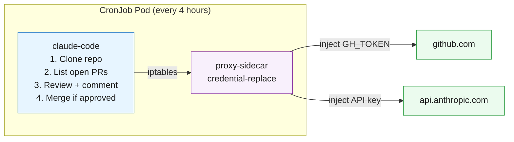

# 04 - Claude Code as Code Reviewer

An autonomous code review agent that runs on a schedule, checks for open PRs, reviews them, and merges when appropriate.

## Problem

You want automated code reviews on every PR — checking for tests, security issues, and style — without human reviewers being a bottleneck. The agent needs GitHub access (to read PRs and post comments) and Anthropic API access (to reason about code).

## Solution

A Kubernetes CronJob runs Claude Code on a schedule. The transparent proxy handles credential injection — the agent uses `gh` CLI normally and the proxy injects the real `GH_TOKEN`. A ConfigMap delivers the review prompt and configuration.



## Key Features

- **Idempotent**: Already-reviewed PRs are skipped (detected via sentinel comment)
- **Scheduled**: Runs automatically every 4 hours via CronJob
- **Secure**: Both Anthropic API key and GitHub token (`GH_TOKEN`) are secured via sidecar proxy
- **Autonomous**: Reviews, comments, and merges without human intervention

## Prerequisites

- Kind cluster running with secrets (`make all` or see [01-kind-cluster](../01-kind-cluster/))
- Both images built and loaded (`make build && make load`)
- `.env` file with `ANTHROPIC_API_KEY`, `GH_TOKEN`, and `TESTING_REPO`

## Step-by-Step

All commands run from the **project root**.

### 1. Run with Make (recommended)

```bash
make run-04
make logs-04         # Claude output
make proxy-logs-04   # proxy ALLOWED/BLOCKED log
```

### 2. Or manually

```bash
# Apply configmaps (substitute TESTING_REPO from .env)
set -a && source .env && set +a
envsubst '$TESTING_REPO' < 04-code-reviewer/manifests/configmap.yaml | kubectl apply -f -
kubectl apply -f 04-code-reviewer/manifests/proxy-configmap.yaml
kubectl apply -f 04-code-reviewer/manifests/job.yaml

# Watch output
kubectl logs -f job/claude-reviewer -c claude-code -n 04-code-reviewer
```

### 3. Re-run

```bash
make run-04
# Or manually:
kubectl delete job claude-reviewer -n 04-code-reviewer --ignore-not-found
kubectl apply -f 04-code-reviewer/manifests/job.yaml
```

> **Scheduled use**: `manifests/cronjob.yaml` runs the reviewer automatically (e.g., every 4 hours).

## How to Verify

1. After the job completes, check the target repo for new review comments with the sentinel tag `<!-- claude-reviewer -->`

2. Verify the agent skips already-reviewed PRs (those with both `<!-- claude-reviewer -->` and "Approved") on subsequent runs

## Expected Output

```
Cloning csantanapr/kcd-nyc-hello...
Found 2 open PRs.
PR #3: Already reviewed. Skipping.
PR #5: Reviewing...
  - Code looks good, no issues found.
  - Approving and merging PR #5.
Done. Reviewed 1 PR, skipped 1.
```

## Cleanup

```bash
kubectl delete -f manifests/job.yaml
kubectl delete -f manifests/configmap.yaml
kubectl delete secret agent-credentials -n 04-code-reviewer
```
