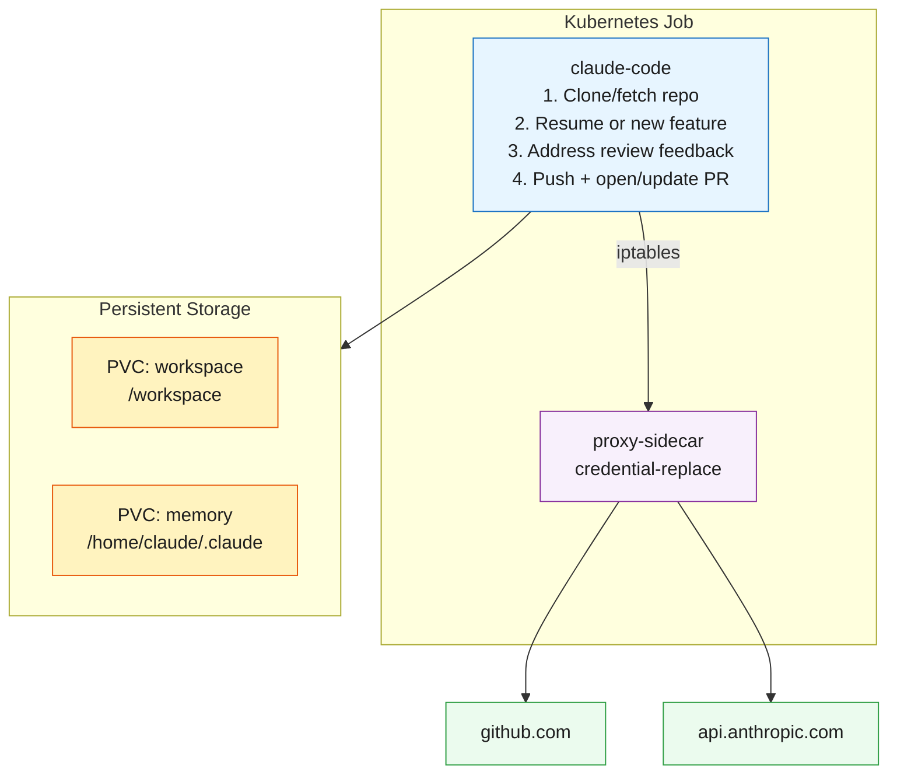

# 05 - Claude Code as Developer Agent

An autonomous developer agent that implements features, submits PRs, and addresses review comments. Uses persistent storage to maintain workspace and Claude memory across pod restarts.

## Problem

A one-shot Job (concept 04) works for reviews, but a developer agent needs to remember its previous work — the code it checked out, the PR it opened, the session context. Without persistence, every run starts from scratch and can't iterate on feedback.

## Solution

PersistentVolumeClaims (PVCs) give the agent durable storage for its workspace and Claude's session memory. Combined with `--continue` (session resume), the agent picks up where it left off — reading new review comments and addressing them without re-cloning or re-implementing.



## Key Features

- **Persistent workspace**: Code and git history survive pod restarts via PVC
- **Session resume**: Claude's memory and session state persist, enabling multi-run workflows
- **PR lifecycle**: Creates PRs, and on subsequent runs addresses review comments
- **Multi-agent**: Works with the Code Reviewer (concept 04) — reviewer leaves comments, developer addresses them

## Prerequisites

- Kind cluster running with secrets (`make all` or see [01-kind-cluster](../01-kind-cluster/))
- Both images built and loaded (`make build && make load`)
- `.env` file with `ANTHROPIC_API_KEY`, `GH_TOKEN`, and `TESTING_REPO`

## Step-by-Step

All commands run from the **project root**.

### 1. Run with Make (recommended)

```bash
make run-05
make logs-05         # Claude output
make proxy-logs-05   # proxy ALLOWED/BLOCKED log
```

### 2. Or manually

```bash
# Apply configmaps and PVCs (substitute TESTING_REPO from .env)
set -a && source .env && set +a
envsubst '$TESTING_REPO' < 05-developer-agent/manifests/configmap.yaml | kubectl apply -f -
kubectl apply -f 05-developer-agent/manifests/proxy-configmap.yaml
kubectl apply -f 05-developer-agent/manifests/pvc.yaml
kubectl apply -f 05-developer-agent/manifests/job.yaml

# Watch output
kubectl logs -f job/claude-developer -c claude-code -n 05-developer-agent
```

### 3. Re-run after review comments

After the Code Reviewer (concept 04) or a human leaves comments on the PR:

```bash
make run-05
# Or manually:
kubectl delete job claude-developer -n 05-developer-agent --ignore-not-found
kubectl apply -f 05-developer-agent/manifests/job.yaml
```

The agent will resume its session, read the review comments, and address them.

## How to Verify

1. Check the target repo for a new PR created by the agent
2. The PR should have the sentinel tag `<!-- claude-developer -->` in the body
3. On subsequent runs, verify the agent pushes new commits addressing review comments

## Expected Output (first run — picks next feature from SPEC.md)

```
Starting Claude Developer...
Target repo: csantanapr/kcd-nyc-hello
Model: claude-haiku-4-5-20251001
---
Cloning csantanapr/kcd-nyc-hello...
Reading SPEC.md roadmap...
Next unclaimed feature: "Health endpoint"
Creating branch: claude/feature/health-endpoint
Implementing feature...
Marking feature as done in SPEC.md...
Committing and pushing...
Opening PR #12: "Add /api/health endpoint with uptime and version"
Done. PR created successfully.
```

## Expected Output (subsequent run — resumes open PR)

```
Starting Claude Developer...
Resuming session...
Found existing PR #12 with 2 review comments.
Addressing comment 1: "Add tests for the /api/health endpoint"
Addressing comment 2: "Include Node.js version in response"
Committing fixes and pushing...
Done. Addressed 2 review comments.
```

## Expected Output (all features complete)

```
Starting Claude Developer...
Target repo: csantanapr/kcd-nyc-hello
---
Reading SPEC.md roadmap...
All roadmap features are implemented!
```

## Cleanup

```bash
kubectl delete -f manifests/job.yaml
kubectl delete -f manifests/configmap.yaml
kubectl delete secret agent-credentials -n 05-developer-agent
# To fully reset (lose workspace and memory):
kubectl delete -f manifests/pvc.yaml
```
