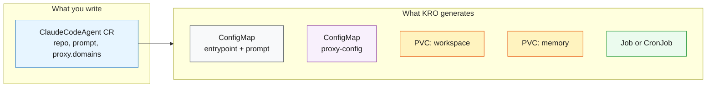

# 06 - KRO ClaudeCodeAgent Abstraction

Define a `ClaudeCodeAgent` custom resource using [KRO](https://kro.run/) that encapsulates the entire agent pattern behind a simple API.

## Problem

Deploying a Claude Code agent (concepts 04-05) requires creating 5+ resources manually: ConfigMap, PVCs, proxy-config, Job/CronJob — each with specific env vars, volume mounts, and init containers. This boilerplate is error-prone to copy across teams and environments.

## Solution

A single `ClaudeCodeAgent` custom resource replaces all the boilerplate. KRO's ResourceGraphDefinition generates everything from a concise spec — including the proxy allowlist, credentials, and scheduling.



## What KRO Generates

From a single `ClaudeCodeAgent` instance, KRO creates 6 resources:

| # | Resource | Condition |
|---|----------|-----------|
| 1 | ConfigMap (proxy allowlist) | Always |
| 2 | ConfigMap (entrypoint + prompt + env vars) | Always |
| 3 | PVC (workspace for cloned repos) | Always |
| 4 | PVC (Claude memory for session resume) | Always |
| 5 | Job (one-shot agent) | `schedule == ""` |
| 6 | CronJob (recurring agent) | `schedule != ""` |

## Prerequisites

- Completed concepts [01](../01-kind-cluster/) through [05](../05-developer-agent/) (Kind cluster running, images built)
- [KRO](https://kro.run) installed in the cluster

## Step-by-Step

All commands run from the **project root**.

### 1. Ensure cluster is ready

The namespace and secret are created by the cluster setup script:

```bash
bash 01-kind-cluster/scripts/create-cluster.sh
```

### 2. Install KRO (skip if already installed)

```bash
helm list -n kro-system | grep -q kro || \
  helm install kro oci://registry.k8s.io/kro/charts/kro --namespace kro-system --create-namespace
kubectl wait --for=condition=Available deploy -n kro-system --all --timeout=60s
```

### 3. Apply the ResourceGraphDefinition

```bash
kubectl apply -f 06-kro-agent/manifests/rgd.yaml
kubectl wait --for=condition=Ready rgd/claudecodeagent --timeout=30s
```

Verify the CRD was generated:

```bash
kubectl get crd claudecodeagents.kro.run
```

### 4. Deploy a Developer (one-shot Job)

```bash
set -a && source .env && set +a
envsubst '$TESTING_REPO' < 06-kro-agent/manifests/developer-instance.yaml | kubectl apply -f -
```

Watch progress:

```bash
kubectl wait --for=condition=Ready claudecodeagent/claude-developer -n 06-kro-agent --timeout=60s
kubectl logs -f -l kro.run/instance-name=claude-developer -c claude-code -n 06-kro-agent
```

### 5. Check proxy logs

```bash
kubectl logs -l kro.run/instance-name=claude-developer -c proxy-sidecar -n 06-kro-agent
```

## How to Verify

```bash
# Check the custom resources
kubectl get claudecodeagent -n 06-kro-agent

# See what KRO created for the reviewer (CronJob + ConfigMap + PVCs)
kubectl get configmap,pvc,cronjob -n 06-kro-agent -l app.kubernetes.io/managed-by=kro

# See what KRO created for the developer (Job + ConfigMap + PVCs)
kubectl get configmap,pvc,job -n 06-kro-agent -l app.kubernetes.io/managed-by=kro

# Trigger a manual reviewer run
kubectl create job --from=cronjob/claude-reviewer claude-reviewer-manual -n 06-kro-agent

# Watch logs
kubectl logs job/claude-reviewer-manual -c claude-code -n 06-kro-agent -f
kubectl logs job/claude-developer -c claude-code -n 06-kro-agent -f

# Verify fake credentials in main container (not real secrets)
kubectl exec job/claude-developer -c claude-code -n 06-kro-agent -- env | grep -E 'API_KEY|GH_TOKEN'
```

## Expected Output

```
# kubectl get claudecodeagent -n 06-kro-agent
NAME               AGE
claude-reviewer    10s
claude-developer   5s

# kubectl get configmap,pvc,cronjob,job -n 06-kro-agent
NAME                              DATA   AGE
configmap/claude-reviewer-config  8      10s
configmap/claude-developer-config 8      5s

NAME                                        STATUS   CAPACITY   AGE
persistentvolumeclaim/claude-reviewer-workspace   Bound    5Gi        10s
persistentvolumeclaim/claude-reviewer-memory       Bound    1Gi        10s
persistentvolumeclaim/claude-developer-workspace  Bound    5Gi        5s
persistentvolumeclaim/claude-developer-memory      Bound    1Gi        5s

NAME                           SCHEDULE       SUSPEND   ACTIVE
cronjob.batch/claude-reviewer  0 */4 * * *    False     0

NAME                        COMPLETIONS   DURATION   AGE
job.batch/claude-developer  0/1           5s         5s
```

## Cleanup

```bash
# Delete instances (KRO garbage-collects all child resources)
kubectl delete claudecodeagent claude-reviewer claude-developer -n 06-kro-agent

# Remove the RGD
kubectl delete -f 06-kro-agent/manifests/rgd.yaml
```

## Comparison: Before and After KRO

**Before (concept 04/05):** Each agent requires manually creating a ConfigMap, Job/CronJob, and PVCs with ~100 lines of YAML, duplicating the sidecar proxy pattern.

**After (concept 06):** A single `ClaudeCodeAgent` resource with ~20 lines of user-facing YAML. The platform team maintains the RGD; developers just specify their agent name, repo, and prompt.
