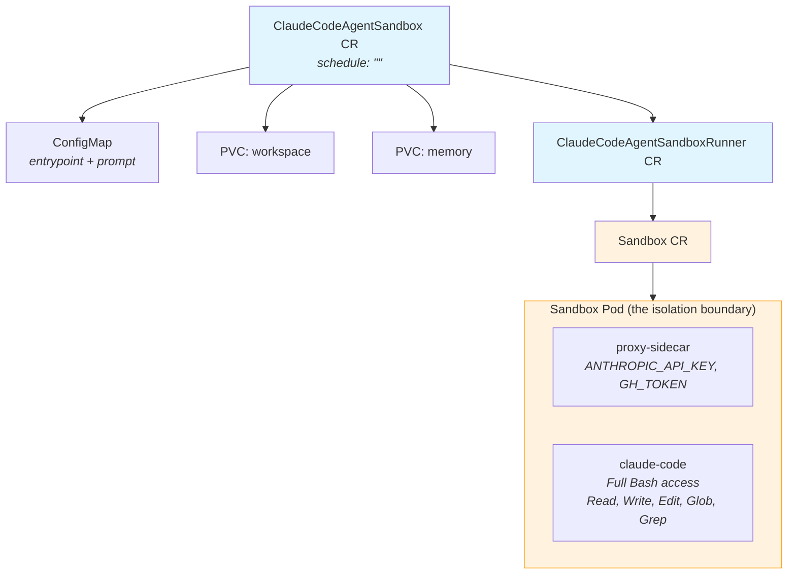
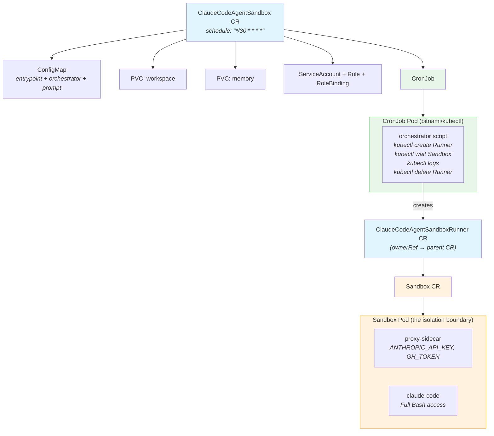

# Concept 07: Agent Sandbox Isolation

Run Claude Code agents inside [agent-sandbox](https://github.com/kubernetes-sigs/agent-sandbox) pods for **process-level isolation**. The `Sandbox` CRD from `kubernetes-sigs/agent-sandbox` provides lifecycle management and optional kernel-level isolation via gVisor.

Claude Code **always runs fully inside a Sandbox** with full Bash access — the sandbox IS the isolation boundary. Two RGDs work together:

- **`ClaudeCodeAgentSandboxRunner`** (internal) — creates a single Sandbox CR
- **`ClaudeCodeAgentSandbox`** (user-facing) — orchestrates PVCs, ConfigMap, and either a Runner (standalone) or a CronJob that creates Runners on schedule

## What You Learn

- How `kubernetes-sigs/agent-sandbox` provides lifecycle-managed sandbox pods
- How two RGDs compose (parent creates child CRs) for clean separation of concerns
- How a CronJob orchestrator uses `kubectl` to create, monitor, and cleanup Runner instances
- How `ownerReferences` enable proper garbage collection across the resource chain
- How `stream-json` output piped through `jq` produces readable, structured logs

## Architecture

### Standalone Mode (no schedule)

The parent CR creates a Runner directly. The Runner creates a Sandbox with full Bash access.



### CronJob Orchestrator Mode (with schedule)

The parent CR creates RBAC + CronJob. The CronJob pod uses `kubectl` to create a Runner, wait for it to finish, stream logs, then delete it.



Key design decisions:
- **Claude always runs in a Sandbox** — no MCP routing, no split execution
- **PVCs are siblings** — owned by parent CR, survive Runner deletion
- **ownerReferences** — Runner points to parent CR for garbage collection on deletion
- **Stale cleanup** — orchestrator deletes leftover Runners (by label) before creating new ones
- **Log streaming** — `kubectl logs -f` attaches while pod is alive, captures all output

## Prerequisites

- Completed concepts [01](../../01-kind-cluster/) through [06](../../06-kro-agent/)
- Kind cluster running with KRO installed
- `claude-code:latest` and `credential-proxy:latest` images loaded into Kind

## Step-by-Step

### 1. Create the namespace and secret

```bash
kubectl create namespace 07-sandbox 2>/dev/null || true

set -a && source .env && set +a
kubectl create secret generic agent-credentials \
  --from-literal=ANTHROPIC_API_KEY=$ANTHROPIC_API_KEY \
  --from-literal=GH_TOKEN=$GH_TOKEN \
  -n 07-sandbox
```

### 2. Load the kubectl image for CronJob mode

```bash
docker pull bitnami/kubectl:latest
kind load docker-image bitnami/kubectl:latest --name claude-demo
```

### 3. Install agent-sandbox controller

```bash
export VERSION="v0.4.3"
kubectl apply -f https://github.com/kubernetes-sigs/agent-sandbox/releases/download/${VERSION}/manifest.yaml
kubectl wait --for=condition=Available deploy -n agent-sandbox-system --all --timeout=60s
```

Verify:

```bash
kubectl get crd sandboxes.agents.x-k8s.io
```

### 4. Apply both RGDs

The Runner RGD must be applied first (its CRD is referenced by the parent):

```bash
kubectl apply -f 07-sandbox/agent-sandbox/manifests/rgd-runner.yaml
kubectl wait --for=condition=Ready rgd/claudecodeagentsandboxrunner --timeout=30s

kubectl apply -f 07-sandbox/agent-sandbox/manifests/rgd.yaml
kubectl wait --for=condition=Ready rgd/claudecodeagentsandbox --timeout=30s
```

Verify both CRDs exist:

```bash
kubectl get crd claudecodeagentsandboxrunners.kro.run claudecodeagentsandboxes.kro.run
```

### 5. Run the standalone smoke test

Claude Code runs directly inside a Sandbox with full Bash:

```bash
kubectl apply -f 07-sandbox/agent-sandbox/manifests/test-standalone.yaml
```

Wait for the Sandbox to be ready, then stream logs:

```bash
kubectl wait --for=condition=Ready sandbox/sandbox-test-sandbox -n 07-sandbox --timeout=60s
kubectl logs -f sandbox-test-sandbox -c claude-code -n 07-sandbox
```

#### Expected Output

```
Starting Sandbox Tester...
Target repo: none
Model: claude-haiku-4-5-20251001
Mode: sandbox (full Bash)
---
>>> I'll run through all the sandbox isolation tests.
[Bash] {"command":"git --version"}
[Bash] {"command":"echo \"SANDBOX_ECHO_OK\""}
[Bash] {"command":"python3 -c \"print('PYTHON_OK')\""}
[Bash] {"command":"node -e \"console.log('NODE_OK')\""}
[Bash] {"command":"go version"}
...
| # | Test | Result |
|---|------|--------|
| 1 | git --version | PASS |
| 2 | echo "SANDBOX_ECHO_OK" | PASS |
| 3 | python3 | PASS |
| 4 | node | PASS |
| 5 | go version | PASS |
| 6 | File creation | PASS |
| 7 | Line count | PASS |
| 8 | Sandbox file write | PASS |
| 9 | Cross-tool read | PASS |
| 10 | hostname | PASS |

**SANDBOX TEST COMPLETE**
[done] All tests completed...
=== Complete (exit: 0) ===
```

#### Cleanup

```bash
kubectl delete claudecodeagentsandbox sandbox-test -n 07-sandbox
```

### 6. Run the CronJob orchestrator smoke test

Tests the full orchestrator flow: CronJob → creates Runner → Sandbox runs → logs streamed → cleanup:

```bash
kubectl apply -f 07-sandbox/agent-sandbox/manifests/test-cronjob.yaml
```

Verify the CronJob resources:

```bash
kubectl get claudecodeagentsandbox,cronjob,sa,role,rolebinding -n 07-sandbox
```

Trigger a manual run:

```bash
kubectl create job --from=cronjob/sandbox-test-cron sandbox-test-cron-manual -n 07-sandbox
```

Stream the orchestrator logs (includes full agent output):

```bash
kubectl logs -f job/sandbox-test-cron-manual -n 07-sandbox
```

#### Expected Output

```
Creating Runner: sandbox-test-cron-run-1777954434
claudecodeagentsandboxrunner.kro.run/sandbox-test-cron-run-1777954434 created
Waiting for sandbox sandbox-test-cron-run-1777954434-sandbox to start...
sandbox.agents.x-k8s.io/sandbox-test-cron-run-1777954434-sandbox condition met
=== Runner logs ===
Starting Sandbox CronJob Tester...
Target repo: none
Model: claude-haiku-4-5-20251001
Mode: sandbox (full Bash)
---
>>> I'll run through all the test phases...
[Bash] {"command":"git --version"}
...
**CRONJOB SANDBOX TEST COMPLETE**
=== Complete (exit: 0) ===
sandbox.agents.x-k8s.io/sandbox-test-cron-run-1777954434-sandbox condition met
Cleaning up Runner: sandbox-test-cron-run-1777954434
claudecodeagentsandboxrunner.kro.run "sandbox-test-cron-run-1777954434" deleted
=== Orchestrator complete ===
```

Notice: both modes use `[Bash]` — Claude always runs inside a Sandbox with full Bash access.

#### Cleanup

```bash
kubectl delete claudecodeagentsandbox sandbox-test-cron -n 07-sandbox
kubectl delete job sandbox-test-cron-manual -n 07-sandbox --ignore-not-found
```

### 7. Deploy the developer agent (standalone)

One-shot agent that runs directly inside a Sandbox:

```bash
set -a && source .env && set +a
envsubst '$TESTING_REPO' < 07-sandbox/agent-sandbox/manifests/developer-instance.yaml | kubectl apply -f -
```

Watch it work:

```bash
kubectl wait --for=condition=Ready sandbox/claude-developer-sandbox -n 07-sandbox --timeout=60s
kubectl logs -f claude-developer-sandbox -c claude-code -n 07-sandbox
```

### 8. Deploy the reviewer agent (CronJob orchestrator)

Scheduled agent that creates a fresh Sandbox on each run:

```bash
envsubst '$TESTING_REPO' < 07-sandbox/agent-sandbox/manifests/reviewer-instance.yaml | kubectl apply -f -
```

Trigger manually:

```bash
kubectl create job --from=cronjob/claude-reviewer claude-reviewer-manual -n 07-sandbox
kubectl logs -f job/claude-reviewer-manual -n 07-sandbox
```

### 9. Run the full feature cycle

The developer and reviewer work together:

1. Developer addresses issues, PR feedback, or implements the next feature
2. Reviewer reviews PRs, requests changes (missing tests), resolves merge conflicts, and merges

```bash
# Run developer (standalone — addresses all PRs in one run)
set -a && source .env && set +a
envsubst '$TESTING_REPO' < 07-sandbox/agent-sandbox/manifests/developer-instance.yaml | kubectl apply -f -
kubectl wait --for=condition=Ready sandbox/claude-developer-sandbox -n 07-sandbox --timeout=60s
kubectl logs -f claude-developer-sandbox -c claude-code -n 07-sandbox

# After developer finishes, run reviewer (CronJob)
kubectl create job --from=cronjob/claude-reviewer claude-reviewer-manual -n 07-sandbox
kubectl logs -f job/claude-reviewer-manual -n 07-sandbox
```

## Cleanup

```bash
# Delete agent instances
kubectl delete claudecodeagentsandbox claude-developer claude-reviewer sandbox-test sandbox-test-cron -n 07-sandbox --ignore-not-found
kubectl delete job sandbox-test-cron-manual claude-reviewer-manual -n 07-sandbox --ignore-not-found

# Delete both RGDs
kubectl delete -f 07-sandbox/agent-sandbox/manifests/rgd.yaml
kubectl delete -f 07-sandbox/agent-sandbox/manifests/rgd-runner.yaml

# Uninstall agent-sandbox controller
kubectl delete -f https://github.com/kubernetes-sigs/agent-sandbox/releases/download/v0.4.3/manifest.yaml
```

## What Changed from Concept 06

| Aspect | Concept 06 | Concept 07 |
|---|---|---|
| Execution | Job or CronJob | Sandbox (standalone) or CronJob → Sandbox (scheduled) |
| Isolation | None — code runs in Job pod | Sandbox CRD provides process isolation |
| Bash | Full access always | Full access always (inside Sandbox) |
| Architecture | Single RGD | Two RGDs: Runner (internal) + parent (user-facing) |
| CronJob mode | Claude runs in CronJob pod | CronJob is just an orchestrator (`bitnami/kubectl`) |
| PVC management | Standalone PVCs in RGD | Standalone PVCs owned by parent, passed to Runner by name |
| Ownership | KRO owns everything | ownerReferences for GC + label-based stale cleanup |
| Log streaming | Direct pod logs | Orchestrator attaches `kubectl logs -f` before pod finishes |
| New dependency | None | `kubernetes-sigs/agent-sandbox` controller, `bitnami/kubectl` |
