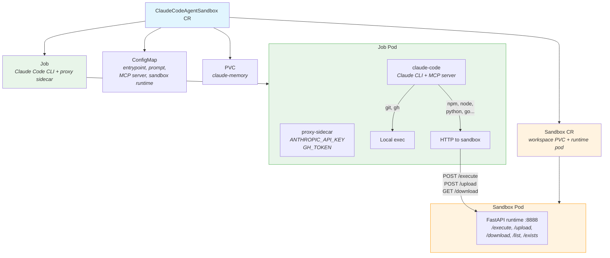

# Concept 07: Agent Sandbox Isolation

Run Claude Code agents with **isolated command execution** — the agent's Bash tool is replaced by an MCP server that **routes commands**: git/gh run locally (for speed and credential access), while everything else (npm, node, python, go) runs in a separate [agent-sandbox](https://github.com/kubernetes-sigs/agent-sandbox) pod. Files are automatically synced between local and sandbox using the SDK-compatible filesystem API.

## What You Learn

- How `--disallowedTools Bash` removes the Bash tool from Claude Code
- How an MCP server (FastMCP, stdio) provides a `sandbox_execute` tool with smart routing
- How the agent-sandbox Python SDK's filesystem APIs (upload, download, list, exists) enable file sync
- How `kubernetes-sigs/agent-sandbox` provides lifecycle-managed sandbox pods with stable DNS
- How the RGD's `allowedLocalCommands` field lets platform teams control what runs locally vs. in sandbox
- How `stream-json` output piped through `jq` produces readable, structured logs

## Architecture



The MCP server checks each command against a whitelist:
- **`git`, `gh`** (configurable) → run locally in the Job pod
- **Everything else** → sync workspace to sandbox, execute via HTTP, sync results back

The sandbox runtime implements the same API as the official `python-runtime-sandbox` from kubernetes-sigs/agent-sandbox, making it compatible with the Python SDK's `CommandExecutor` and `Filesystem` classes.

## Prerequisites

- Completed concepts [01](../../01-kind-cluster/) through [06](../../06-kro-agent/)
- Kind cluster running with KRO installed
- `claude-code:latest` and `credential-proxy:latest` images loaded into Kind

## Step-by-Step

### 1. Rebuild the Claude Code image

Concept 07 requires additional Python packages (FastMCP, FastAPI, uvicorn, requests) and `jq`:

```bash
cd 02-claude-k8s-job
docker build -t claude-code:latest .
kind load docker-image claude-code:latest --name claude-demo
cd ..
```

### 2. Install agent-sandbox controller

```bash
export VERSION="v0.4.3"
kubectl apply -f https://github.com/kubernetes-sigs/agent-sandbox/releases/download/${VERSION}/manifest.yaml
kubectl wait --for=condition=Available deploy -n agent-sandbox-system --all --timeout=60s
```

Verify:

```bash
kubectl get crd sandboxes.agents.x-k8s.io
```

### 3. Apply the RGD

```bash
kubectl apply -f 07-sandbox/agent-sandbox/manifests/rgd.yaml
```

Verify the CRD was created:

```bash
kubectl get crd claudecodeagentsandboxes.kro.run
```

### 4. Run the smoke test

Before deploying real agents, run the built-in test instance that exercises every sandbox capability:

```bash
kubectl apply -f 07-sandbox/agent-sandbox/manifests/test-instance.yaml
```

Wait for it to complete:

```bash
kubectl wait --for=condition=complete job/sandbox-test -n claude-demo --timeout=180s
```

View the logs:

```bash
kubectl logs -l job-name=sandbox-test -c claude-code -n claude-demo --tail=-1
```

#### Expected Output

The logs use `stream-json` output piped through `jq`, producing structured lines:

- `>>> ...` — assistant text (what Claude is thinking/saying)
- `[tool_name] {...}` — tool calls with input parameters
- `[done] ...` — final result summary

```
Waiting for sandbox at http://sandbox-test-sandbox.claude-demo.svc.cluster.local:8888...
Sandbox ready.
Starting Sandbox Tester...
Target repo: none
Model: claude-haiku-4-5-20251001
Sandbox: http://sandbox-test-sandbox.claude-demo.svc.cluster.local:8888
Allowed local: git,gh
---
>>> I'll run through all the sandbox isolation tests systematically.
[mcp__sandbox__sandbox_execute] {"command":"git --version"}
[mcp__sandbox__sandbox_execute] {"command":"echo \"SANDBOX_ECHO_OK\""}
[mcp__sandbox__sandbox_execute] {"command":"python3 -c \"print('PYTHON_OK')\""}
[mcp__sandbox__sandbox_execute] {"command":"node -e \"console.log('NODE_OK')\""}
[mcp__sandbox__sandbox_execute] {"command":"go version"}
>>> Phase 3: File sync local to sandbox.
[Write] {"file_path":"/workspace/test-input.txt","content":"line one\nline two\nline three\n"}
[mcp__sandbox__sandbox_execute] {"command":"cat /workspace/test-input.txt"}
[mcp__sandbox__sandbox_execute] {"command":"wc -l < /workspace/test-input.txt"}
[mcp__sandbox__sandbox_execute] {"command":"echo \"created-in-sandbox\" > /workspace/sandbox-output.txt"}
[Read] {"file_path":"/workspace/sandbox-output.txt"}
>>> Phase 5: Isolation proof.
[mcp__sandbox__sandbox_execute] {"command":"hostname"}
[Read] {"file_path":"/etc/hostname"}
>>> All tests completed:

| # | Test | Result |
|---|------|--------|
| 1 | git --version (local) | PASS |
| 2 | echo "SANDBOX_ECHO_OK" (sandbox) | PASS |
| 3 | python3 (sandbox) | PASS |
| 4 | node (sandbox) | PASS |
| 5 | go version (sandbox) | PASS |
| 6 | cat /workspace/test-input.txt (file sync in) | PASS |
| 7 | wc -l (file sync in) | PASS |
| 8 | echo > sandbox file (sandbox create) | PASS |
| 9 | Read sandbox file locally (file sync out) | PASS |
| 10 | Hostname isolation proof | PASS |

**SANDBOX TEST COMPLETE**
[done] All tests completed...
=== Complete (exit: 0) ===
```

#### What Each Test Proves

| Phase | Tests | What It Proves |
|-------|-------|----------------|
| **Smart Routing** | 1-2 | `git` runs locally in the Job pod (fast, credentials available); `echo` routes to the sandbox pod via HTTP |
| **Sandbox Runtimes** | 3-5 | Python, Node.js, and Go are all available inside the sandbox — the agent can build and test code in any language |
| **File Sync In** | 6-7 | Claude's `Write` tool creates a file locally, the MCP server tars and uploads it to the sandbox before execution, and the sandbox can read it |
| **File Sync Out** | 8-9 | A command creates a file inside the sandbox, the MCP server downloads it back after execution, and Claude's `Read` tool can access it locally |
| **Isolation Proof** | 10 | The sandbox pod has a different hostname than the Job pod, proving commands execute in a separate container |

#### Tools Used in the Test

| Tool | Provider | What It Does |
|------|----------|--------------|
| `mcp__sandbox__sandbox_execute` | MCP server (FastMCP, stdio) | Routes shell commands — whitelisted ones run locally, others run in sandbox with automatic file sync |
| `Write` | Claude Code built-in | Creates files on the local filesystem (Job pod) |
| `Read` | Claude Code built-in | Reads files from the local filesystem (Job pod) — verifies file sync brought sandbox files back |

The test does **not** use `Bash` — it was removed via `--disallowedTools Bash`. All shell execution goes through the MCP `sandbox_execute` tool.

#### Sandbox Pod Logs

You can also check the sandbox pod to see the SDK-compatible API calls:

```bash
kubectl logs sandbox-test-sandbox -n claude-demo --tail=20
```

Expected — HTTP requests for upload (file sync in), execute (command runs), and download (file sync out):

```
INFO:     POST /upload HTTP/1.1    200 OK
INFO:     POST /execute HTTP/1.1   200 OK
INFO:     GET /download/_syncback.tar.gz HTTP/1.1  200 OK
```

#### Cleanup the Test

```bash
kubectl delete claudecodeagentsandbox sandbox-test -n claude-demo
```

If the CR gets stuck in `DELETING` state, force-remove it:

```bash
kubectl patch claudecodeagentsandbox sandbox-test -n claude-demo --type merge -p '{"metadata":{"finalizers":null}}'
```

### 5. Deploy the developer agent

```bash
set -a && source .env && set +a
envsubst '$TESTING_REPO' < 07-sandbox/agent-sandbox/manifests/developer-instance.yaml | kubectl apply -f -
```

### 6. Verify resources

```bash
kubectl get claudecodeagentsandbox,sandbox,configmap,pvc,job,pod -n claude-demo
```

You should see:
- A `ClaudeCodeAgentSandbox` CR
- A `Sandbox` CR (`claude-developer-sandbox`)
- A ConfigMap (`claude-developer-config`)
- Two PVCs (`workspace-claude-developer-sandbox` and `claude-developer-memory`)
- A Job (`claude-developer`)
- Two pods (sandbox runtime + job pod with proxy sidecar)

### 7. Verify sandbox isolation

Check that the Job pod has fake credentials:

```bash
JOB_POD=$(kubectl get pod -n claude-demo -l job-name=claude-developer -o name)
kubectl exec $JOB_POD -c claude-code -n claude-demo -- env | grep -E 'API_KEY|GH_TOKEN'
```

Expected: `FAKE_KEY_REPLACED_BY_PROXY` and `FAKE_GH_TOKEN_REPLACED_BY_PROXY`

### 8. Watch the agent work

```bash
kubectl logs -f $JOB_POD -c claude-code -n claude-demo
```

You should see:
1. "Waiting for sandbox..." then "Sandbox ready."
2. `>>> ` prefixed text (Claude's reasoning)
3. `[mcp__sandbox__sandbox_execute]` tool calls — git/gh run locally, npm/node in sandbox
4. `[done]` with the final result

### 9. (Optional) Deploy the reviewer agent

```bash
envsubst '$TESTING_REPO' < 07-sandbox/agent-sandbox/manifests/reviewer-instance.yaml | kubectl apply -f -
```

### 10. (Optional) Customize the whitelist

To allow additional commands to run locally (e.g., `curl`):

```yaml
spec:
  allowedLocalCommands: "git,gh,curl"
```

## Cleanup

```bash
# Delete agent instances
kubectl delete claudecodeagentsandbox claude-developer claude-reviewer sandbox-test -n claude-demo --ignore-not-found

# Delete the RGD
kubectl delete -f 07-sandbox/agent-sandbox/manifests/rgd.yaml

# Uninstall agent-sandbox controller
kubectl delete -f https://github.com/kubernetes-sigs/agent-sandbox/releases/download/v0.4.3/manifest.yaml
```

## What Changed from Concept 06

| Aspect | Concept 06 | Concept 07 |
|---|---|---|
| Bash execution | Direct in Job pod | Smart routing via MCP: git/gh local, rest → sandbox |
| Isolation | None | Code runs in separate Sandbox pod |
| File sync | N/A | Automatic tar-based sync via SDK filesystem API |
| Log output | Raw `stream-json` | `stream-json` piped through `jq` for readable `>>>`, `[tool]`, `[done]` lines |
| New dependency | None | `kubernetes-sigs/agent-sandbox` controller, `jq` |
| Claude Code flags | Standard | `--disallowedTools Bash --mcp-config` |
| Sandbox runtime | N/A | SDK-compatible FastAPI (execute, upload, download, list, exists) |
| Credential model | Proxy for API + git | Proxy for API; git/gh local via proxy; GH_TOKEN to sandbox |
| Configurable | Model, schedule | Model + `allowedLocalCommands` whitelist |
