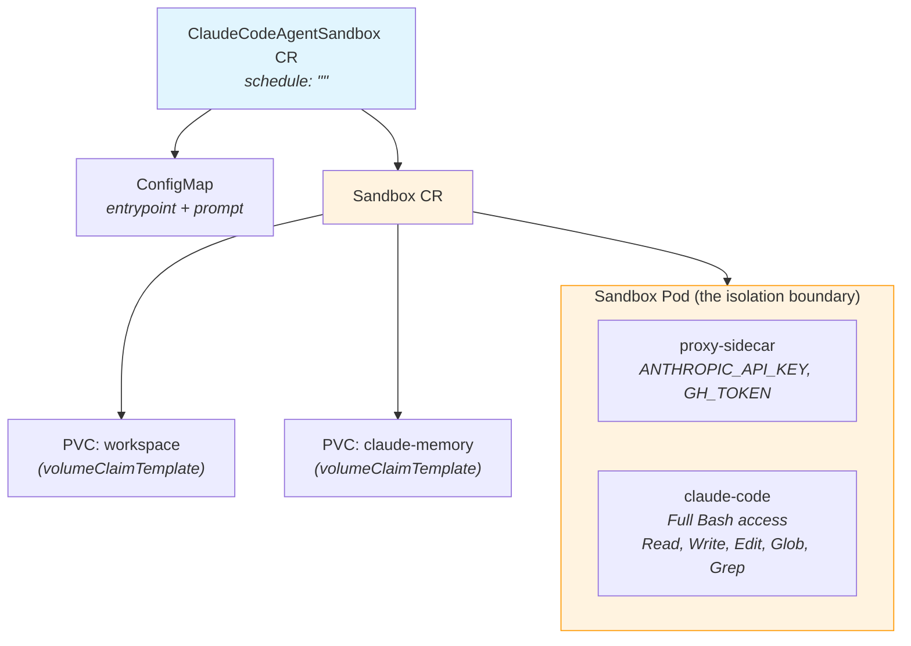
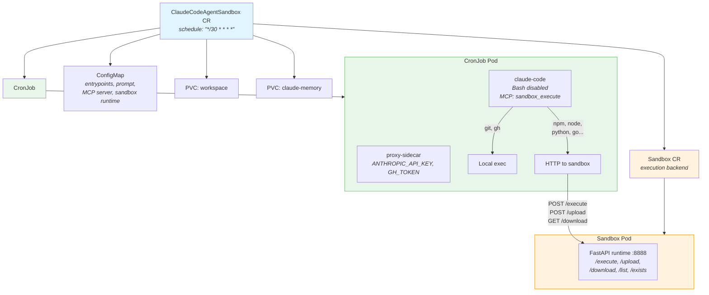

# Concept 07: Agent Sandbox Isolation

Run Claude Code agents inside [agent-sandbox](https://github.com/kubernetes-sigs/agent-sandbox) pods for **process-level isolation**. The `Sandbox` CRD from `kubernetes-sigs/agent-sandbox` provides lifecycle management, persistent storage via `volumeClaimTemplates`, and optional kernel-level isolation via gVisor.

The RGD supports two modes based on the `schedule` field:

- **No schedule (default)** — a single **Sandbox** runs Claude Code directly with full Bash access. The sandbox IS the isolation boundary. Simplest setup.
- **With schedule** — a **CronJob** runs Claude on a cron schedule, with a separate **Sandbox** as the execution backend. Bash is disabled; commands route through an MCP server that runs git/gh locally and everything else in the sandbox.

## What You Learn

- How `kubernetes-sigs/agent-sandbox` provides lifecycle-managed sandbox pods with `volumeClaimTemplates`
- How the same RGD generates different resources based on a `schedule` field (using KRO `includeWhen`)
- How `--disallowedTools Bash` + MCP server enables smart command routing (CronJob mode)
- How `stream-json` output piped through `jq` produces readable, structured logs

## Architecture

### Sandbox-Only Mode (no schedule)

Claude Code runs directly inside the Sandbox pod with full Bash access. The Sandbox manages its own PVCs via `volumeClaimTemplates`.



### CronJob + Execution Sandbox Mode (with schedule)

The Sandbox CRD doesn't support scheduling natively, so a CronJob provides the schedule and a separate Sandbox provides isolated command execution.



The MCP server checks each command against a configurable whitelist (`allowedLocalCommands`):
- **`git`, `gh`** (default) → run locally in the CronJob pod (fast, credentials available)
- **Everything else** → sync workspace to sandbox, execute via HTTP, sync results back

## Prerequisites

- Completed concepts [01](../../01-kind-cluster/) through [06](../../06-kro-agent/)
- Kind cluster running with KRO installed
- `claude-code:latest` and `credential-proxy:latest` images loaded into Kind

## Step-by-Step

### 1. Create the namespace and secret

```bash
kubectl create namespace 07-sandbox 2>/dev/null || true

set -a && source .env && set +a
kubectl create secret generic agent-credentials \
  --from-literal=ANTHROPIC_API_KEY=$ANTHROPIC_API_KEY \
  --from-literal=GH_TOKEN=$GH_TOKEN \
  -n 07-sandbox
```

### 2. Rebuild the Claude Code image

Concept 07 requires additional Python packages (FastMCP, FastAPI, uvicorn, requests) and `jq`:

```bash
cd 02-claude-k8s-job
docker build -t claude-code:latest .
kind load docker-image claude-code:latest --name claude-demo
cd ..
```

### 3. Install agent-sandbox controller

```bash
export VERSION="v0.4.3"
kubectl apply -f https://github.com/kubernetes-sigs/agent-sandbox/releases/download/${VERSION}/manifest.yaml
kubectl wait --for=condition=Available deploy -n agent-sandbox-system --all --timeout=60s
```

Verify:

```bash
kubectl get crd sandboxes.agents.x-k8s.io
```

### 4. Apply the RGD

```bash
kubectl apply -f 07-sandbox/agent-sandbox/manifests/rgd.yaml
```

Verify the CRD was created:

```bash
kubectl get crd claudecodeagentsandboxes.kro.run
```

### 5. Run the standalone smoke test

The test instance runs in **sandbox-only mode** (no schedule) — Claude Code runs directly inside the Sandbox with full Bash access:

```bash
kubectl apply -f 07-sandbox/agent-sandbox/manifests/test-standalone.yaml
```

Wait for the Sandbox pod to complete (note: no Job — the Sandbox pod runs Claude directly):

```bash
kubectl wait --for=jsonpath='{.status.phase}'=Succeeded \
  pod -l agents.x-k8s.io/sandbox-name-hash -n 07-sandbox --timeout=180s
```

View the logs:

```bash
kubectl logs sandbox-test-sandbox -c claude-code -n 07-sandbox --tail=-1
```

#### Expected Output

The logs use `stream-json` output piped through `jq`, producing structured lines:

- `>>> ...` — assistant text (what Claude is thinking/saying)
- `[tool_name] {...}` — tool calls with input parameters
- `[done] ...` — final result summary

```
Starting Sandbox Tester...
Target repo: none
Model: claude-haiku-4-5-20251001
Mode: sandbox (full Bash)
---
>>> I'll run through all the sandbox isolation tests.
[Bash] {"command":"git --version"}
[Bash] {"command":"echo \"SANDBOX_ECHO_OK\""}
[Bash] {"command":"python3 -c \"print('PYTHON_OK')\""}
[Bash] {"command":"node -e \"console.log('NODE_OK')\""}
[Bash] {"command":"go version"}
>>> Creating test file for Phase 3:
[Write] {"file_path":"/workspace/test-input.txt","content":"line one\nline two\nline three\n"}
[Bash] {"command":"cat /workspace/test-input.txt"}
[Bash] {"command":"wc -l < /workspace/test-input.txt"}
[Bash] {"command":"echo \"created-in-sandbox\" > /workspace/sandbox-output.txt"}
[Read] {"file_path":"/workspace/sandbox-output.txt"}
>>> Phase 5: Environment check.
[Bash] {"command":"hostname"}
[Read] {"file_path":"/etc/hostname"}
>>> All tests completed:

| # | Test | Result |
|---|------|--------|
| 1 | git --version | PASS |
| 2 | echo "SANDBOX_ECHO_OK" | PASS |
| 3 | python3 | PASS |
| 4 | node | PASS |
| 5 | go version | PASS |
| 6 | cat /workspace/test-input.txt | PASS |
| 7 | wc -l | PASS |
| 8 | echo > sandbox file | PASS |
| 9 | Read sandbox file | PASS |
| 10 | hostname check | PASS |

**SANDBOX TEST COMPLETE**
[done] All tests completed...
=== Complete (exit: 0) ===
```

Notice: in sandbox-only mode, Claude uses the **`[Bash]`** tool directly (not `[mcp__sandbox__sandbox_execute]`). All commands run inside the Sandbox pod — the sandbox IS the isolation.

#### What Each Test Proves

| Phase | Tests | What It Proves |
|-------|-------|----------------|
| **Command Execution** | 1-2 | Shell commands work inside the sandbox |
| **Runtime Support** | 3-5 | Python, Node.js, and Go are all available |
| **Write → Bash** | 6-7 | Claude's `Write` tool creates files, `Bash` can read them |
| **Bash → Read** | 8-9 | `Bash` creates files, Claude's `Read` tool can access them |
| **Environment** | 10 | Confirms execution environment (hostname matches sandbox pod) |

#### Cleanup the Standalone Test

```bash
kubectl delete claudecodeagentsandbox sandbox-test -n 07-sandbox
```

### 6. Run the CronJob + execution sandbox smoke test

This test runs in **CronJob mode** (with schedule) — Claude Code runs in a CronJob pod with Bash disabled, routing commands through an MCP server to a separate Sandbox execution backend:

```bash
kubectl apply -f 07-sandbox/agent-sandbox/manifests/test-cronjob.yaml
```

Verify the resources were created:

```bash
kubectl get claudecodeagentsandbox,sandbox,cronjob,pvc -n 07-sandbox
```

You should see:
- A `ClaudeCodeAgentSandbox` CR (`sandbox-test-cron`)
- A `Sandbox` CR (`sandbox-test-cron-sandbox`) — the execution backend
- A `CronJob` (`sandbox-test-cron`)
- Two standalone PVCs (`sandbox-test-cron-workspace` and `sandbox-test-cron-memory`)

To trigger a run immediately (instead of waiting for the cron schedule):

```bash
kubectl create job sandbox-test-cron-manual --from=cronjob/sandbox-test-cron -n 07-sandbox
```

Wait for the job to complete:

```bash
kubectl wait --for=condition=complete job/sandbox-test-cron-manual -n 07-sandbox --timeout=180s
```

View the logs:

```bash
kubectl logs job/sandbox-test-cron-manual -c claude-code -n 07-sandbox --tail=-1
```

#### Expected Output (CronJob Mode)

```
Starting Sandbox CronJob Tester...
Target repo: none
Model: claude-haiku-4-5-20251001
Mode: cronjob (MCP sandbox routing)
Sandbox: http://sandbox-test-cron-sandbox.07-sandbox.svc.cluster.local:8888
Allowed local: git,gh
---
>>> I'll run through all the CronJob sandbox tests.
[mcp__sandbox__sandbox_execute] {"command":"git --version"}
[mcp__sandbox__sandbox_execute] {"command":"echo CRONJOB_ECHO_OK"}
[mcp__sandbox__sandbox_execute] {"command":"python3 -c \"print('PYTHON_OK')\""}
[mcp__sandbox__sandbox_execute] {"command":"node -e \"console.log('NODE_OK')\""}
[mcp__sandbox__sandbox_execute] {"command":"go version"}
...
**CRONJOB SANDBOX TEST COMPLETE**
[done] All tests completed...
=== Complete (exit: 0) ===
```

Notice: in CronJob mode, Claude uses **`[mcp__sandbox__sandbox_execute]`** instead of `[Bash]`. The MCP server routes `git` and `gh` locally, everything else goes to the execution Sandbox.

#### What Each Test Proves (CronJob Mode)

| Phase | Tests | What It Proves |
|-------|-------|----------------|
| **Local Routing** | 1 | `git` commands route locally (fast, credentials available) |
| **Sandbox Routing** | 2-5 | Non-whitelisted commands route to execution Sandbox |
| **File Operations** | 6-7 | Files created in sandbox are accessible across commands |
| **Local Commands** | 8-9 | `git config` and `gh` run locally with proper configuration |
| **Environment** | 10 | Reports sandbox hostname (different from CronJob pod) |

#### Cleanup the CronJob Test

```bash
kubectl delete claudecodeagentsandbox sandbox-test-cron -n 07-sandbox
kubectl delete job sandbox-test-cron-manual -n 07-sandbox --ignore-not-found
```

### 7. Deploy the developer agent (sandbox-only)

One-shot agent that runs directly inside a Sandbox (no schedule):

```bash
set -a && source .env && set +a
envsubst '$TESTING_REPO' < 07-sandbox/agent-sandbox/manifests/developer-instance.yaml | kubectl apply -f -
```

### 8. Verify resources

```bash
kubectl get claudecodeagentsandbox,sandbox,configmap,pvc,pod -n 07-sandbox
```

You should see:
- A `ClaudeCodeAgentSandbox` CR
- A `Sandbox` CR (`claude-developer-sandbox`) with two PVCs (managed via `volumeClaimTemplates`)
- A ConfigMap (`claude-developer-config`)
- One pod (sandbox with proxy sidecar + claude-code)
- **No Job or CronJob** (sandbox-only mode)

### 9. Watch the agent work

```bash
kubectl logs -f claude-developer-sandbox -c claude-code -n 07-sandbox
```

You should see:
1. `Mode: sandbox (full Bash)` in the header
2. `>>> ` prefixed text (Claude's reasoning)
3. `[Bash]` tool calls — all commands run directly in the sandbox
4. `[done]` with the final result

### 10. (Optional) Deploy the reviewer agent with a schedule

Add a `schedule` field to enable CronJob mode with sandbox execution backend:

```bash
envsubst '$TESTING_REPO' < 07-sandbox/agent-sandbox/manifests/reviewer-instance.yaml | kubectl apply -f -
```

In CronJob mode, you'll see:
- A `Sandbox` CR (execution backend with FastAPI runtime)
- A `CronJob` (runs Claude on schedule)
- Two standalone PVCs (persist workspace and memory across CronJob runs)
- `[mcp__sandbox__sandbox_execute]` tool calls instead of `[Bash]`

### 11. (Optional) Customize the whitelist (CronJob mode)

To allow additional commands to run locally in the CronJob pod (e.g., `curl`):

```yaml
spec:
  schedule: "*/30 * * * *"
  allowedLocalCommands: "git,gh,curl"
```

The `allowedLocalCommands` field is ignored in sandbox-only mode (all commands run locally in the sandbox).

## Cleanup

```bash
# Delete agent instances
kubectl delete claudecodeagentsandbox claude-developer claude-reviewer sandbox-test sandbox-test-cron -n 07-sandbox --ignore-not-found
kubectl delete job sandbox-test-cron-manual -n 07-sandbox --ignore-not-found

# Delete the RGD
kubectl delete -f 07-sandbox/agent-sandbox/manifests/rgd.yaml

# Uninstall agent-sandbox controller
kubectl delete -f https://github.com/kubernetes-sigs/agent-sandbox/releases/download/v0.4.3/manifest.yaml
```

## What Changed from Concept 06

| Aspect | Concept 06 | Concept 07 |
|---|---|---|
| Execution | Job or CronJob | Sandbox (one-shot) or CronJob + Sandbox (scheduled) |
| Isolation | None — code runs in Job pod | Sandbox CRD provides process isolation |
| Bash | Full access always | Full in sandbox-only; disabled + MCP routing in CronJob mode |
| PVC management | Standalone PVCs | `volumeClaimTemplates` (sandbox-only) or standalone PVCs (CronJob) |
| Log output | Raw `stream-json` | `stream-json` piped through `jq` for readable `>>>`, `[tool]`, `[done]` lines |
| New dependency | None | `kubernetes-sigs/agent-sandbox` controller, `jq` |
| Scheduling | `schedule` field → Job or CronJob | `schedule` field → Sandbox-only or CronJob + execution Sandbox |
| Credential model | Proxy for API + git | Same proxy pattern in both modes |
