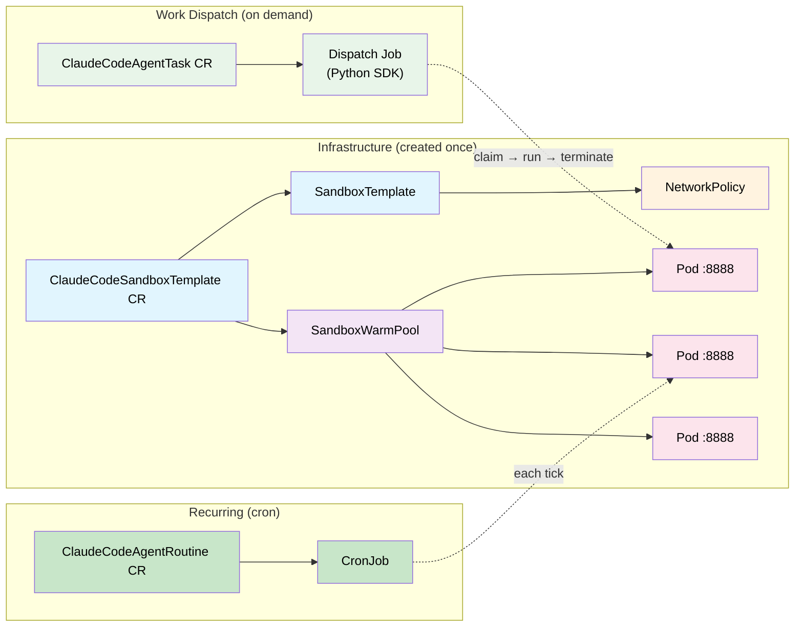

# 08 — SandboxTemplate: Warm Pools + Python SDK + Managed NetworkPolicy

Uses agent-sandbox **Extension CRDs** (`SandboxTemplate`, `SandboxClaim`, `SandboxWarmPool`) with a long-running sandbox runtime and the **Python SDK** (`k8s-agent-sandbox`) for dispatching work.

- **Warm pool instant-start** — pods are pre-warmed with proxy and runtime ready; tasks adopt them instantly
- **Fresh pod per task** — after a task completes, the pod is terminated and the pool replenishes
- **Managed NetworkPolicy** — secure-by-default network isolation
- **Python SDK dispatcher** — uses `SandboxClient.create_sandbox()` with Pod IP routing, retries, and connection recovery
- **3-RGD separation** — Template (infra), Task (one-shot), Routine (recurring)
- **Real coding agents** — a developer (Task) and reviewer (Routine) run the full PR feature cycle on the warm pool ([see below](#coding-agents-developer--reviewer))

## Architecture



## How It Works

### Lifecycle of a Task

1. **User creates** a `ClaudeCodeAgentTask` CR specifying `templateName` and `prompt`
2. **KRO creates** a dispatch Job running the Python SDK dispatcher
3. **Dispatcher** calls `SandboxClient.create_sandbox(template=..., warmpool="default")`
4. **SDK** creates a `SandboxClaim` → controller adopts a warm pod from the pool
5. **Dispatcher** calls `sandbox.commands.run("claude -p ... -- '<prompt>'")` via direct Pod IP
6. **Claude Code** executes inside the sandbox pod (with proxy intercepting credentials)
7. **Dispatcher** calls `sandbox.terminate()` → claim + sandbox + pod deleted
8. **WarmPool** detects replica count dropped → creates a replacement pod

### Warm Pool Replenishment

```
Pool: 5 ready pods
  Task claims Pod 1 → Pool: 4 ready + 1 replenishing
  Task finishes, terminates Pod 1 → Pool: 4 ready + 1 replenishing
  New pod becomes ready → Pool: 5 ready
```

Multiple tasks can run in parallel (one per warm pod). If tasks arrive faster than pods replenish, claims queue until a pod becomes ready.

### NetworkPolicy

The `SandboxTemplate` uses `networkPolicyManagement: Managed` with custom rules:
- **Ingress**: only pods with label `app: sandbox-dispatcher` can reach sandbox pods (dispatch Jobs)
- **Egress**: allows public internet and the EC2 metadata endpoint (`169.254.169.254/32`, needed for Bedrock workload-identity auth), but blocks the rest of the link-local range and RFC1918 private networks to prevent lateral movement.

> **Note:** Kind's default CNI (kindnet) does **not** enforce NetworkPolicy, so these rules
> are advisory in this demo — they take effect on a cluster with an enforcing CNI (Cilium,
> Calico). The metadata-endpoint allow is what lets Bedrock auth work once enforcement is on.

### Update Strategy

When the template changes (new model, proxy config, etc.), the warm pool uses `updateStrategy: Recreate` — all stale warm pods are replaced immediately. Active (in-use) pods are not affected.

## The 3 Custom Resources

### ClaudeCodeSandboxTemplate — Infrastructure

Creates a `SandboxTemplate` + `SandboxWarmPool` and maintains a fleet of sandbox pods. You create one per configuration.

```yaml
apiVersion: kro.run/v1alpha1
kind: ClaudeCodeSandboxTemplate
metadata:
  name: claude-template
spec:
  replicas: 5              # How many warm pods to maintain
  model: "us.anthropic.claude-haiku-4-5-20251001-v1:0"
  credentials:
    secretName: agent-credentials
  proxy:
    domains:
      - host: api.anthropic.com
        credential_env: ANTHROPIC_API_KEY
      - host: api.github.com
        credential_env: GH_TOKEN
```

### ClaudeCodeAgentTask — One-Shot Execution

Dispatches a single prompt to a warm pod from the template.

```yaml
apiVersion: kro.run/v1alpha1
kind: ClaudeCodeAgentTask
metadata:
  name: fix-login-bug
spec:
  templateName: claude-template
  agentName: "Bug Fixer"
  model: "us.anthropic.claude-haiku-4-5-20251001-v1:0"
  repo: "myorg/myapp"
  task: "Fix the login timeout bug"
  prompt: |
    Clone the repo, find the bug, fix it, and create a PR.
```

### ClaudeCodeAgentRoutine — Recurring Execution

CronJob that dispatches work on a schedule. Each tick gets a fresh pod.

```yaml
apiVersion: kro.run/v1alpha1
kind: ClaudeCodeAgentRoutine
metadata:
  name: nightly-review
spec:
  templateName: claude-template
  schedule: "0 2 * * *"    # Every night at 2am
  agentName: "PR Reviewer"
  model: "us.anthropic.claude-haiku-4-5-20251001-v1:0"
  repo: "myorg/myapp"
  prompt: |
    Review all open PRs and leave constructive feedback.
```

## Python SDK Dispatcher

The dispatcher (`dispatcher/dispatch.py`) uses the `k8s-agent-sandbox` Python SDK:

```python
from k8s_agent_sandbox import SandboxClient
from k8s_agent_sandbox.models import SandboxInClusterConnectionConfig

client = SandboxClient(
    connection_config=SandboxInClusterConnectionConfig(server_port=8888, use_pod_ip=True)
)

sandbox = client.create_sandbox(template="claude-template", namespace="...", warmpool="default")
sandbox.commands.run('git config --global user.name "Agent"')
result = sandbox.commands.run('claude -p --dangerously-skip-permissions -- "prompt"', timeout=3600)
print(result.stdout)
sandbox.terminate()
```

SDK features used:
- **`SandboxInClusterConnectionConfig`** — connects directly to sandbox pod (no Router needed)
- **`use_pod_ip=True`** — bypasses DNS, routes via Pod IP for lower latency
- **Automatic retries** — 5 retries with exponential backoff on 500/502/503/504
- **`sandbox.commands.run()`** — sends `POST /execute` to the sandbox runtime, returns `ExecutionResult(stdout, stderr, exit_code)`
- **`sandbox.terminate()`** — deletes claim + sandbox + pod (clean teardown)

**Notes:**
- Requires `kubernetes` Python client v31 — v36 has a [regression](https://github.com/kubernetes-client/python/issues/2582) where the in-cluster Bearer token isn't sent, so all API calls fail as `system:anonymous`.
- The sandbox runtime's `/execute` handler is a **synchronous** FastAPI route (`def`, not `async def`) so the long-running `claude` subprocess runs in a threadpool and never blocks the event loop — otherwise the liveness probe times out and the kubelet kills the pod mid-task.
- The dispatcher passes the prompt through `shlex.quote` (single quotes) so bash inside `/execute` does not evaluate backtick fences, `$VARS`, or `$(...)` in the agent prompt before Claude sees it. `TARGET_REPO`/`AGENT_TASK` are exported onto the `claude` process so prompt shell snippets like `gh repo clone "$TARGET_REPO"` expand correctly.

## Prerequisites

1. Kind cluster running with images loaded: `make all`
2. Dispatcher image built and loaded:
   ```bash
   docker build -t sandbox-dispatcher:latest 08-sandboxtemplate/dispatcher/
   kind load docker-image sandbox-dispatcher:latest --name claude-demo
   ```
3. KRO installed:
   ```bash
   helm install kro oci://registry.k8s.io/kro/charts/kro --namespace kro-system --create-namespace
   ```
4. Agent-sandbox v0.4.6 (core + extensions):
   ```bash
   kubectl apply -f https://github.com/kubernetes-sigs/agent-sandbox/releases/download/v0.4.6/manifest.yaml
   kubectl apply -f https://github.com/kubernetes-sigs/agent-sandbox/releases/download/v0.4.6/extensions.yaml
   kubectl wait --for=condition=Available deploy -n agent-sandbox-system --all --timeout=60s
   ```

## Step-by-Step

### 1. Apply the 3 RGDs

```bash
kubectl apply -f 08-sandboxtemplate/manifests/rgd-template.yaml
kubectl apply -f 08-sandboxtemplate/manifests/rgd-task.yaml
kubectl apply -f 08-sandboxtemplate/manifests/rgd-routine.yaml
```

### 2. Create a sandbox template (starts the warm pool)

```bash
set -a && source .env && set +a
envsubst '$ANTHROPIC_MODEL' < 08-sandboxtemplate/manifests/test-template.yaml | kubectl apply -f -
```

Watch the warm pool come up:

```bash
kubectl get sandboxwarmpool -n 08-sandboxtemplate -w
# NAME                    READY   AGE
# claude-template-pool    5       45s
```

### 3. Dispatch a one-shot task

```bash
set -a && source .env && set +a
envsubst '$ANTHROPIC_MODEL' < 08-sandboxtemplate/manifests/test-task.yaml | kubectl apply -f -
```

Watch the dispatch:

```bash
kubectl logs -f job/test-task-dispatch -n 08-sandboxtemplate
```

### 4. (Optional) Create a recurring routine

```bash
set -a && source .env && set +a
envsubst '$ANTHROPIC_MODEL' < 08-sandboxtemplate/manifests/test-routine.yaml | kubectl apply -f -
```

## Coding Agents: Developer + Reviewer

Beyond the simple smoke-test task, this concept ships two real autonomous coding agents —
the same developer/reviewer pair as concept 07, but running on the warm-pool + SDK
architecture. Both reference the shared `claude-template` and need its proxy allowlist to
include `github.com` (git clone/push) and `registry.npmjs.org` (`npm install`), which
`test-template.yaml` already provides.

| Agent | Kind | Trigger | What it does |
|-------|------|---------|--------------|
| **Developer** (`developer-task.yaml`) | `ClaudeCodeAgentTask` | one-shot, on demand | Triages work: open issues → PR review feedback → next `SPEC.md` feature. Opens/updates PRs. |
| **Reviewer** (`reviewer-routine.yaml`) | `ClaudeCodeAgentRoutine` | cron (`*/10 * * * *`) | Reviews open PRs, requests changes if tests are missing, approves + merges when they pass. |

The two coordinate through sentinel-tagged PR comments (`<!-- claude-developer -->` /
`<!-- claude-reviewer -->`), driving the feature cycle: developer opens a PR without tests →
reviewer requests tests → developer adds them → reviewer approves and merges.

### Run the feature cycle

```bash
set -a && source .env && set +a

# 1. Ensure the template/warm pool is up (proxy allowlist includes github.com + npm)
envsubst '$ANTHROPIC_MODEL' < 08-sandboxtemplate/manifests/test-template.yaml | kubectl apply -f -

# 2. Run the developer once — implements the next feature / addresses PR feedback
envsubst '$ANTHROPIC_MODEL $TESTING_REPO' < 08-sandboxtemplate/manifests/developer-task.yaml | kubectl apply -f -
kubectl logs -f job/claude-developer-dispatch -n 08-sandboxtemplate

# 3. Start the reviewer on its schedule (or trigger a run immediately)
envsubst '$ANTHROPIC_MODEL $TESTING_REPO' < 08-sandboxtemplate/manifests/reviewer-routine.yaml | kubectl apply -f -
kubectl create job --from=cronjob/claude-reviewer claude-reviewer-now -n 08-sandboxtemplate
kubectl logs -f job/claude-reviewer-now -n 08-sandboxtemplate
```

Re-run the developer after the reviewer requests changes; repeat until the reviewer merges.
Each run claims a fresh warm pod and re-clones the repo (no persistence — the GitHub repo is
the source of truth), so the agents stay stateless while the pool absorbs the cold-start cost.

## How to Verify

```bash
# Pool is fully warm
kubectl get sandboxwarmpool -n 08-sandboxtemplate

# NetworkPolicy auto-created
kubectl get networkpolicy -n 08-sandboxtemplate

# Task completed
kubectl logs job/test-task-dispatch -n 08-sandboxtemplate | grep "TASK TEST COMPLETE"

# Pod was terminated after task (not lingering)
kubectl get sandboxclaims -n 08-sandboxtemplate
# Should be empty after task completes
```

## Key Differences from Concept 07

| Aspect | 07 (Raw Sandbox) | 08 (Extension CRDs + SDK) |
|--------|-------------------|-------------------------------|
| Pod lifecycle | One-shot (entrypoint runs, exits) | Long-running runtime, terminated after task |
| Startup time | Cold start (init containers + boot) | Instant (warm pool adoption) |
| Work dispatch | Entrypoint script | Python SDK `sandbox.commands.run()` |
| Persistence | PVCs shared across runs | No persistence (repo is state) |
| NetworkPolicy | None (proxy only) | Managed secure-by-default + proxy |
| Architecture | 2 RGDs (Runner + Parent) | 3 RGDs (Template + Task + Routine) |
| Scaling | Manual (one Sandbox at a time) | Pool auto-replenishes + HPA-compatible |
| Dispatcher | bash/kubectl scripts | Python SDK with retries + Pod IP routing |

## Cleanup

```bash
# Agent instances (smoke-test + coding agents)
kubectl delete claudecodeagenttask test-task claude-developer -n 08-sandboxtemplate --ignore-not-found
kubectl delete claudecodeagentroutine test-routine claude-reviewer -n 08-sandboxtemplate --ignore-not-found

# Template (deletes the warm pool + all its pods)
kubectl delete claudecodesandboxtemplate claude-template -n 08-sandboxtemplate --ignore-not-found

# RGDs (removes the CRDs)
kubectl delete rgd claudecodesandboxtemplate claudecodeagenttask claudecodeagentroutine --ignore-not-found
```
