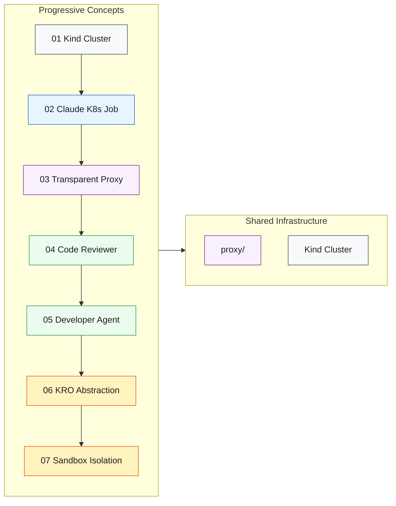

# Platform Engineering for AI Agents: Secure Claude Code Agents on Kubernetes with KRO

Reference implementation for the [KCD New York](https://community.cncf.io/kcd-new-york/) talk — June 10, 2026.

## What This Is

A progressive, hands-on guide showing how to run Claude Code as an AI agent on Kubernetes — from a simple Job to a fully autonomous developer agent with credential isolation and persistent memory.



## Prerequisites

- Docker
- [kind](https://kind.sigs.k8s.io/) (Kubernetes in Docker)
- kubectl
- `envsubst` (included with `gettext` — pre-installed on most systems)
- An Anthropic API key (`ANTHROPIC_API_KEY`)
- A GitHub PAT with write access to your target repo (see [Target Repo Setup](#target-repo-setup))

## Setup

```bash
git clone https://github.com/csantanapr/kcd-new-york-k8s-claude.git
cd kcd-new-york-k8s-claude
cp .env.example .env
# Edit .env and add your real keys
```

## Target Repo Setup

Concepts 04-07 need a GitHub repo to operate on. Create one from the template:

1. Go to [`csantanapr/kcd-nyc-hello-template`](https://github.com/csantanapr/kcd-nyc-hello-template) and click **"Use this template"** → **"Create a new repository"**
2. Name it whatever you like (e.g., `kcd-nyc-hello`) and make it **private** or **public**
3. Create a **GitHub Personal Access Token** (fine-grained) with access to your new repo:
   - Go to **Settings → Developer settings → Personal access tokens → Fine-grained tokens → Generate new token**
   - Set **Repository access** to **"Only select repositories"** and pick your new repo
   - Under **Repository permissions**, grant:
     - **Contents**: Read and write (clone, push)
     - **Pull requests**: Read and write (create, comment, merge PRs)
     - **Metadata**: Read-only (required by default)
4. Set both values in your `.env`:
   ```bash
   # .env
   GH_TOKEN=github_pat_REPLACE_ME
   TESTING_REPO=YOUR_USERNAME/kcd-nyc-hello
   ```

Manifests use `envsubst` to inject the repo at apply-time — no manual YAML editing needed:
```bash
set -a && source .env && set +a
envsubst '$TESTING_REPO' < manifests/configmap.yaml | kubectl apply -f -
```
`set -a` exports all variables so `envsubst` can see them. The `'$TESTING_REPO'` argument restricts substitution to only that variable, leaving other `${}` references (used by shell scripts inside ConfigMaps) untouched. See each concept's README for the exact apply commands.

## Concepts

| # | Concept | What You Learn |
|---|---------|----------------|
| 01 | [Kind Cluster](./01-kind-cluster/) | Create a local K8s cluster for testing |
| 02 | [Claude K8s Job](./02-claude-k8s-job/) | Run Claude Code as a one-shot Kubernetes Job |
| 03 | [Sidecar Proxy](./03-sidecar-proxy/) | Secure credentials with a proxy sidecar pattern |
| 04 | [Code Reviewer](./04-code-reviewer/) | Autonomous PR reviewer running on a CronJob |
| 05 | [Developer Agent](./05-developer-agent/) | Autonomous developer with persistent memory and session resume |
| 06 | [KRO Agent](./06-kro-agent/) | One CRD to rule them all — KRO abstracts the full agent pattern |
| 07 | [Agent Sandbox](./07-sandbox/agent-sandbox/) | Process-level isolation via `kubernetes-sigs/agent-sandbox` — sandbox-only or CronJob + execution sandbox |

See [ROADMAP.md](./ROADMAP.md) for planned future extensions.

## Quick Start

```bash
# 1. Set up credentials
cp .env.example .env
# Edit .env: add ANTHROPIC_API_KEY, GH_TOKEN, TESTING_REPO

# 2. Build images, create cluster, load images (one command)
make all
# If Docker can't reach proxy.golang.org:
# make all GOPROXY=direct

# 3. Run your first Claude Code job (no proxy)
kubectl apply -f 02-claude-k8s-job/manifests/job.yaml
kubectl logs -f job/claude-hello -c claude-code -n 02-claude-k8s-job

# 4. Run with transparent proxy + credential isolation
make run-03
make logs-03         # Claude output
make proxy-logs-03   # see ALLOWED/BLOCKED connections

# 5. Run the autonomous code reviewer
make run-04
make logs-04
```

Run `make help` to see all available targets.

## Notes

- All examples use `claude-haiku-4-5-20251001` model for cost efficiency
- The transparent proxy ([proxy/](./proxy/)) is introduced in concept 03 and used in all subsequent concepts
- Target repo for PR operations is configured via `TESTING_REPO` in `.env` (see [Target Repo Setup](#target-repo-setup))
