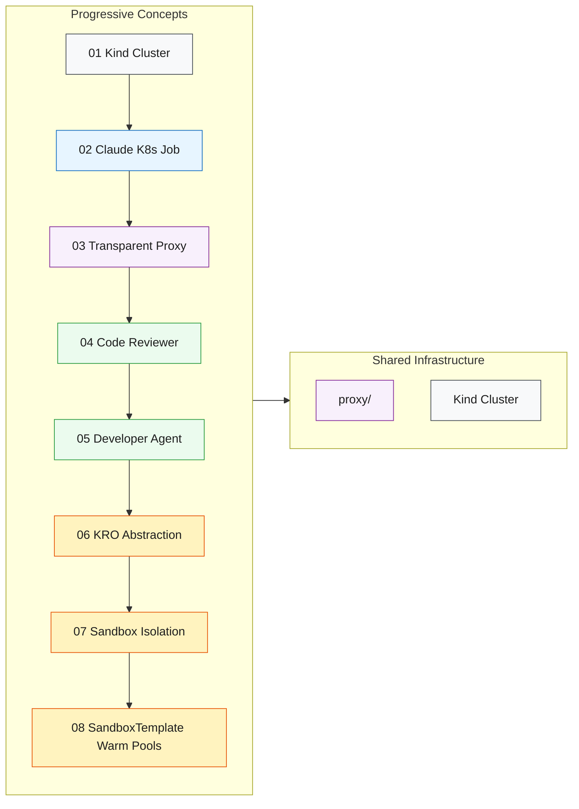

 My setup notes

> This is a fork of [csantanapr/kcd-new-york-k8s-claude](https://github.com/csantanapr/kcd-new-york-k8s-claude), the reference project from the KCD New York talk on running Claude Code agents on Kubernetes. The original code and design are the author's. This section records how I ran it on a Windows laptop and what I changed.

## What I ran

- Windows laptop, Docker Desktop (WSL2 backend), Ubuntu in WSL2
- kind cluster `claude-demo`, kubectl, Helm
- Anthropic API key (no Bedrock), model `claude-haiku-4-5-20251001`
- Stages 02 to 05: a one-shot Job, the credential proxy sidecar, the code reviewer, and the developer agent. I ran the full loop of the developer opening a PR, the reviewer requesting tests, the developer adding them, and the reviewer approving and merging.
- Total API cost for the whole run: about $0.35.

## Windows and WSL2 notes

- Run everything from an **Ubuntu** WSL distro, not the internal `docker-desktop` one. Docker refuses to run its CLI there.
- In Docker Desktop, turn on WSL Integration for your Ubuntu distro.
- Keep the repo in the Linux home folder (`~/`), not under `/mnt/c/`.
- Docker Desktop's built-in Kubernetes can stay on or off. This project creates its own kind cluster, so it isn't needed.

## Three fixes I needed

1. **API-key mode.** The scripts default to Bedrock. Create the cluster with `AUTH_MODE=api-key make cluster`. Setting it only in `.env` was not enough for me.
2. **Shell.** The Makefile uses `source`, which Ubuntu's default `sh` (dash) does not have. Run make with `SHELL=/bin/bash`, for example `make run-05 SHELL=/bin/bash`.
3. **npm registry.** The proxy runs in strict mode, so stage 05's `npm install` is blocked by default. I added `registry.npmjs.org` as a passthrough entry in `05-developer-agent/manifests/proxy-configmap.yaml` (this fork's only code change).

## Setup tips

- Copy `.env.example` to `.env` and fill it in before `make cluster`, because the cluster step creates its secrets from `.env`. Keep `.env` out of git (it is already ignored).
- Use a fine-grained GitHub token limited to the one test repo, with Contents and Pull requests read/write access.
- Stage 04 and 05 act on a separate repo created from the author's `kcd-nyc-hello-template` template.

## What I would change before using this for real

- Give each agent its own identity (bot account or GitHub App) so the reviewer can submit real reviews.
- Require a human approval before merge.
- Use a private package mirror instead of allowing the public npm registry.
- Treat issue text as untrusted input if the developer agent is changed to work from GitHub issues.

---

*Original README follows.*
# Platform Engineering for AI Agents: Secure Claude Code Agents on Kubernetes with KRO

Reference implementation for the [KCD New York](https://community.cncf.io/kcd-new-york/) talk — June 10, 2026.

## What This Is

A progressive, hands-on guide showing how to run Claude Code as an AI agent on Kubernetes — from a simple Job to fleets of sandboxed, autonomous developer and reviewer agents with credential isolation, KRO abstractions, and warm-pool scaling.



## Prerequisites

- Docker
- [kind](https://kind.sigs.k8s.io/) (Kubernetes in Docker)
- kubectl
- `envsubst` (included with `gettext` — pre-installed on most systems)
- **Auth (choose one):**
  - **Bedrock (default):** `aws-vault`, `socat`, AWS profile with Bedrock invoke permissions
  - **API key:** An Anthropic API key (`ANTHROPIC_API_KEY`)
- A GitHub PAT with write access to your target repo (see [Target Repo Setup](#target-repo-setup))

## Setup

```bash
git clone https://github.com/csantanapr/kcd-new-york-k8s-claude.git
cd kcd-new-york-k8s-claude
cp .env.example .env
# Edit .env and add your real keys
```

## Target Repo Setup

Concepts 04-08 need a GitHub repo to operate on. Create one from the template:

1. Go to [`csantanapr/kcd-nyc-hello-template`](https://github.com/csantanapr/kcd-nyc-hello-template) and click **"Use this template"** → **"Create a new repository"**
2. Name it whatever you like (e.g., `kcd-nyc-hello`) and make it **private** or **public**
3. Create a **GitHub Personal Access Token** (fine-grained) with access to your new repo:
   - Go to **Settings → Developer settings → Personal access tokens → Fine-grained tokens → Generate new token**
   - Set **Repository access** to **"Only select repositories"** and pick your new repo
   - Under **Repository permissions**, grant:
     - **Contents**: Read and write (clone, push)
     - **Pull requests**: Read and write (create, comment, merge PRs)
     - **Metadata**: Read-only (required by default)
4. Set both values in your `.env`:
   ```bash
   # .env
   GH_TOKEN=github_pat_REPLACE_ME
   TESTING_REPO=YOUR_USERNAME/kcd-nyc-hello
   ```

Manifests use `envsubst` to inject the repo at apply-time — no manual YAML editing needed:
```bash
set -a && source .env && set +a
envsubst '$TESTING_REPO' < manifests/configmap.yaml | kubectl apply -f -
```
`set -a` exports all variables so `envsubst` can see them. The `'$TESTING_REPO'` argument restricts substitution to only that variable, leaving other `${}` references (used by shell scripts inside ConfigMaps) untouched. See each concept's README for the exact apply commands.

## Concepts

| # | Concept | What You Learn |
|---|---------|----------------|
| 01 | [Kind Cluster](./01-kind-cluster/) | Create a local K8s cluster for testing |
| 02 | [Claude K8s Job](./02-claude-k8s-job/) | Run Claude Code as a one-shot Kubernetes Job |
| 03 | [Sidecar Proxy](./03-sidecar-proxy/) | Secure credentials with a proxy sidecar pattern |
| 04 | [Code Reviewer](./04-code-reviewer/) | Autonomous PR reviewer running on a CronJob |
| 05 | [Developer Agent](./05-developer-agent/) | Autonomous developer with persistent memory and session resume |
| 06 | [KRO Agent](./06-kro-agent/) | One CRD to rule them all — KRO abstracts the full agent pattern |
| 07 | [Agent Sandbox](./07-sandbox/) | Process-level isolation via `kubernetes-sigs/agent-sandbox` — sandbox-only or CronJob + execution sandbox |
| 08 | [SandboxTemplate](./08-sandboxtemplate/) | Warm pools + managed NetworkPolicy + Python SDK dispatch; developer (Task) and reviewer (Routine) coding agents |

See [ROADMAP.md](./ROADMAP.md) for planned future extensions.

## Quick Start

```bash
# 1. Set up credentials
cp .env.example .env
# Edit .env: add GH_TOKEN, TESTING_REPO
# For Bedrock (default): CLAUDE_CODE_USE_BEDROCK=1, AWS_REGION=us-west-2 are pre-set
# For API key: uncomment ANTHROPIC_API_KEY and set it

# 2. Build images, create cluster, load images (one command)
make all

# 3. Run your first Claude Code job (no proxy)
make run-02
make logs-02

# 4. Run with transparent proxy + credential isolation
make run-03
make logs-03         # Claude output
make proxy-logs-03   # see ALLOWED/BLOCKED connections

# 5. Run the autonomous code reviewer
make run-04
make logs-04
```

Run `make help` to see all available targets.

## E2E Tests

Run the full test suite to verify all concepts work end-to-end:

```bash
make test            # All tests (02, 03, 06, 07, 08)
make test-02         # Simple job
make test-03         # Sidecar proxy
make test-06         # KRO agent (skips if KRO not installed)
make test-07         # Sandbox (skips if agent-sandbox CRD not installed)
make test-08         # SandboxTemplate (skips if agent-sandbox extensions not installed)
```

For the full suite, install KRO and agent-sandbox (core + extensions) first:

```bash
helm install kro oci://registry.k8s.io/kro/charts/kro --namespace kro-system --create-namespace
VERSION=$(curl -s https://api.github.com/repos/kubernetes-sigs/agent-sandbox/releases/latest | grep tag_name | cut -d'"' -f4)
kubectl apply -f "https://github.com/kubernetes-sigs/agent-sandbox/releases/download/${VERSION}/manifest.yaml"
kubectl apply -f "https://github.com/kubernetes-sigs/agent-sandbox/releases/download/${VERSION}/extensions.yaml"
```

Concept 08 also needs its dispatcher image built and loaded:

```bash
docker build -t sandbox-dispatcher:latest 08-sandboxtemplate/dispatcher/
kind load docker-image sandbox-dispatcher:latest --name claude-demo
```

## Notes

- Default auth is **Amazon Bedrock** via workload identity (EC2 metadata) — no API key needed
- Model ID is set via `ANTHROPIC_MODEL` in `.env` — defaults to Haiku 4.5 (`us.anthropic.claude-haiku-4-5-20251001-v1:0`); `.env` lists other Bedrock inference profiles (Sonnet/Opus) commented out for easy switching
- The transparent proxy ([proxy/](./proxy/)) is introduced in concept 03 and used in all subsequent concepts
- Target repo for PR operations is configured via `TESTING_REPO` in `.env` (see [Target Repo Setup](#target-repo-setup))
